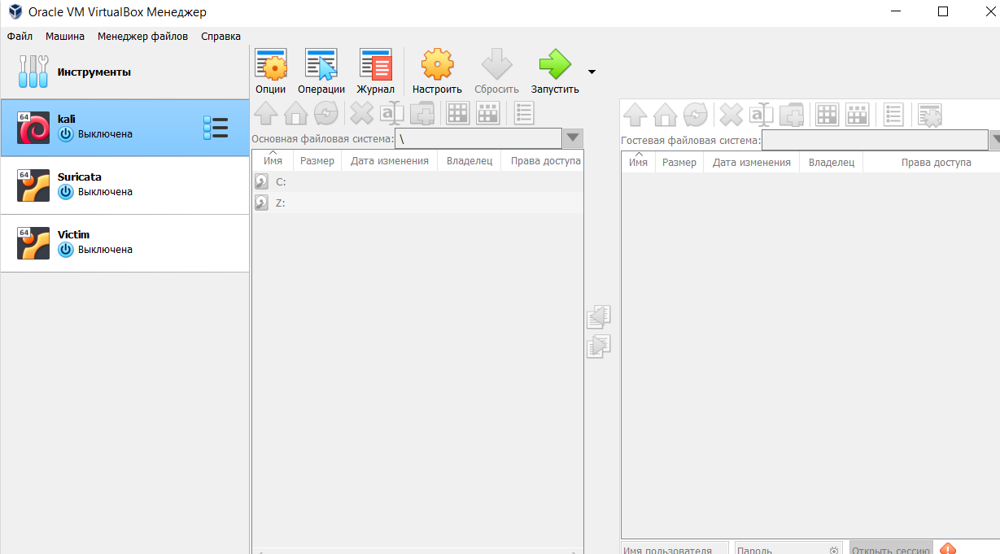
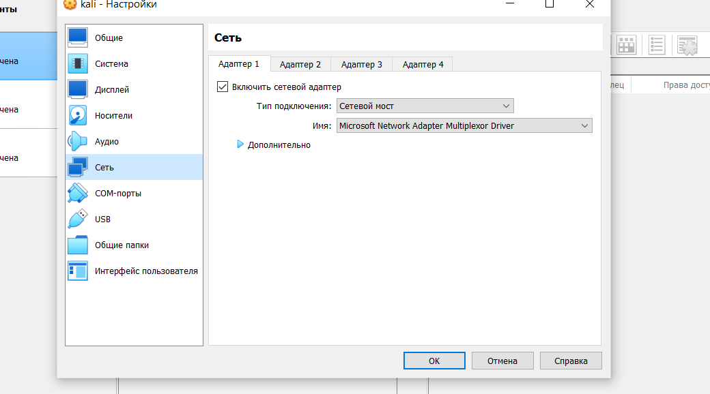
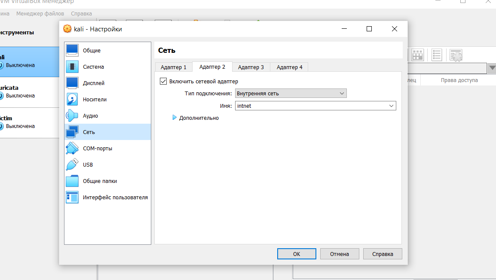
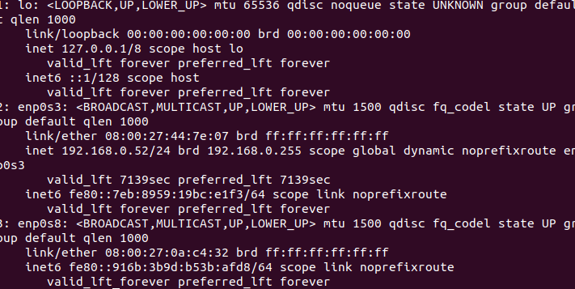
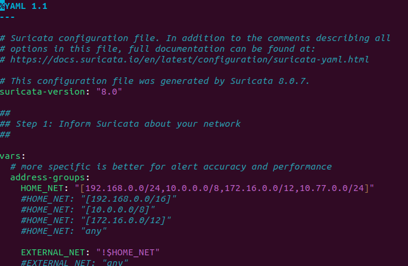
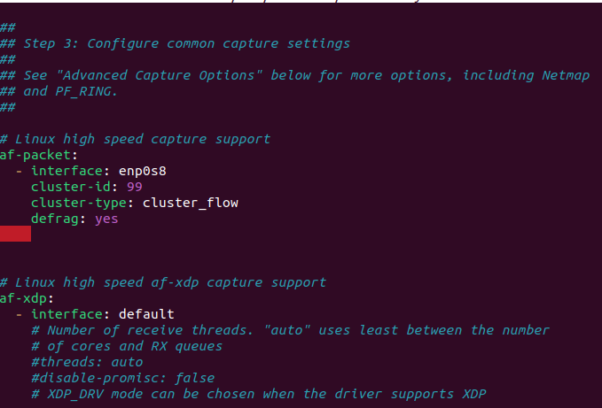
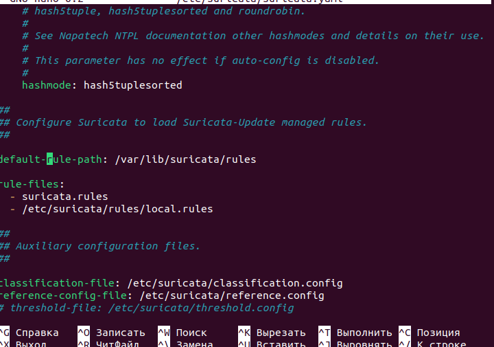
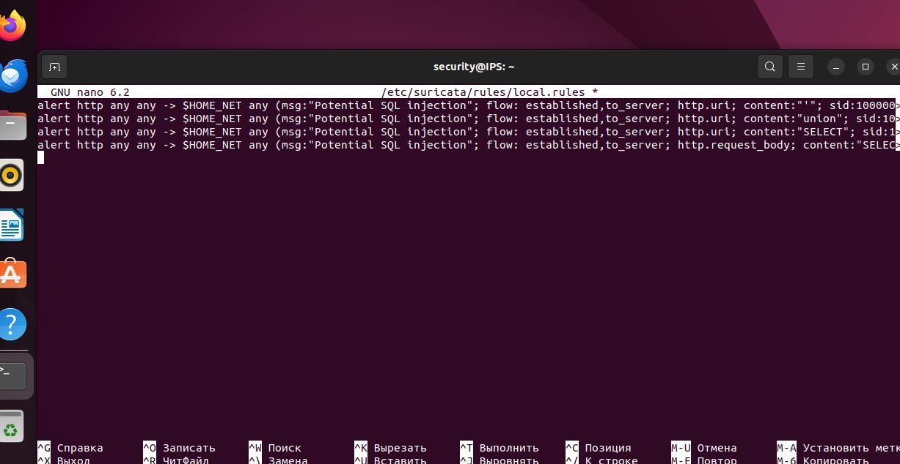

Установка и настройка Suricata IDS в лабораторной сети
1. Введение
В данной лабораторной работе рассматривается развёртывание IDS Suricata в локальной сети, с помощью которой мы будем отслеживать сетевой трафик и обнаруживать потенциальные попытки атак SQL Injection (SQLi).
Suricata — это система обнаружения и предотвращения вторжений (IDS/IPS), которая анализирует сетевые пакеты и проверяет их по заданным правилам. Если сетевой трафик совпадает с каким-либо правилом, Suricata создаёт соответствующее событие, которое мы можем посмотреть в журнале логов.
В нашем случае Suricata будет работать в режиме IDS, то есть только обнаруживать подозрительную активность, не блокируя сам трафик.
Для проведения лабораторной работы мы будем использовать Oracle VirtualBox, в котором развернём несколько виртуальных машин.
2. Подготовка виртуальных машин
В первую очередь нам необходимо развернуть три виртуальные машины:
1.	Атакующая машина. У меня это Kali Linux, так как в ней уже установлено много инструментов для тестирования безопасности. Но если не хотите заморачиваться с образами, можно использовать и обычную Ubuntu, поскольку для наших тестов достаточно команд ping и curl.
2.	Машина-жертва (Victim). Она будет выступать в роли обычного устройства или сервера внутри сети, на который мы будем отправлять тестовые запросы.
3.	Ubuntu с Suricata. На этой виртуальной машине мы установим и настроим нашу IDS, которая будет прослушивать сеть и обнаруживать подозрительные запросы.
Таким образом, у нас получится небольшой лабораторный стенд, на котором можно имитировать сетевую активность и проверять работу собственных правил Suricata.
3. Настройка сети VirtualBox
После создания виртуальных машин необходимо настроить их сетевые адаптеры.
Для этого открываем настройки каждой виртуальной машины в VirtualBox и переходим в раздел «Сеть».
В первом адаптере выбираем режим «Сетевой мост». Он позволит виртуальной машине подключаться к нашей основной локальной сети, в моём случае это сеть 192.168.0.0/24.
Затем включаем второй адаптер и выбираем тип подключения «Внутренняя сеть». Название можно оставить стандартным — intnet.
Внутренняя сеть VirtualBox работает как отдельный виртуальный коммутатор, к которому подключены наши виртуальные машины. Благодаря этому они могут обмениваться трафиком внутри лаборатории.
На виртуальной машине с Suricata для второго адаптера дополнительно выбираем «Режим неразборчивости → Разрешить всё» (Promiscuous Mode: Allow All).
Эта настройка нужна для того, чтобы Suricata могла получать не только пакеты, отправленные непосредственно ей, но и трафик между Kali Linux и Victim.
Стоит учитывать, что режим «Разрешить всё» позволяет получать дополнительный трафик только в пределах возможностей виртуальной сети VirtualBox.
Для дополнительной изоляции лаборатории Victim можно оставить только во внутренней сети intnet, без подключения к домашней сети.

4. Настройка IP-адресов
Теперь запускаем наши виртуальные машины и переходим к настройке сетевых интерфейсов.
Сначала на каждой машине выполняем команду:
ip -br addr
Эта команда показывает список сетевых интерфейсов и назначенные им IP-адреса в сокращённом виде.
Нам необходимо найти интерфейс, относящийся ко второй сетевой карте VirtualBox. В моём случае на Ubuntu он называется enp0s8, но у вас название может отличаться, например eth1.

Настройка Kali Linux
Сначала включаем интерфейс:
sudo ip link set eth1 up
Затем назначаем ему IP-адрес:
sudo ip addr add 10.77.0.10/24 dev eth1
Таким образом, Kali получает адрес 10.77.0.10 во внутренней лабораторной сети.
Настройка Victim
На второй виртуальной машине аналогично включаем интерфейс:
sudo ip link set enp0s8 up
И назначаем IP-адрес:
sudo ip addr add 10.77.0.20/24 dev enp0s8
Теперь Victim имеет адрес 10.77.0.20.
Если адрес уже был назначен ранее, повторно добавлять его не нужно.
Настройка Ubuntu с Suricata
На виртуальной машине с Suricata второй интерфейс достаточно включить:
sudo ip link set enp0s8 up
IP-адрес ему можно не назначать, поскольку данный интерфейс будет использоваться исключительно для прослушивания сетевого трафика.
Теперь проверим, видят ли наши виртуальные машины друг друга.
На атакующей машине выполняем:
ping 10.77.0.20
Если ping проходит и мы получаем ответы от Victim, значит машины находятся в одной сети и могут обмениваться пакетами.
Стоит также учитывать, что IP-адреса, назначенные через ip addr add, являются временными и после перезагрузки машины могут сброситься.
5. Установка Suricata
Теперь переходим к виртуальной машине Ubuntu, на которой будем устанавливать Suricata.
5.1. Обновляем список пакетов
sudo apt update
Эта команда обновляет информацию о доступных пакетах из подключённых репозиториев Ubuntu.
5.2. Устанавливаем необходимые зависимости
sudo apt-get install -y software-properties-common
Данный пакет предоставляет дополнительные средства управления репозиториями, в том числе команду add-apt-repository.
5.3. Добавляем репозиторий Suricata
sudo add-apt-repository ppa:oisf/suricata-stable
sudo apt-get update
Мы добавляем репозиторий Suricata, чтобы получить актуальные пакеты, доступные для нашей версии Ubuntu.
5.4. Устанавливаем Suricata
sudo apt-get install -y suricata
После выполнения команды Suricata будет установлена в систему вместе с необходимыми компонентами.
5.5. Проверяем установку
suricata --version
Если установка прошла успешно, в терминале появится установленная версия Suricata.
6. Настройка suricata.yaml
После установки необходимо перейти к настройке основного конфигурационного файла Suricata — suricata.yaml.
В нём указываются сетевые интерфейсы, защищаемые сети, пути к правилам, параметры журналирования и другие настройки.
Открываем файл:
sudo nano /etc/suricata/suricata.yaml
6.1. Настройка HOME_NET
Находим параметр HOME_NET и добавляем нашу лабораторную сеть:
HOME_NET: "[10.77.0.0/24]"
HOME_NET используется правилами Suricata для обозначения защищаемой сети.
То есть мы указываем, что сеть 10.77.0.0/24 является той сетью, трафик которой мы хотим анализировать.
Важно понимать, что сама по себе настройка HOME_NET не заставляет Suricata получать все пакеты этой сети. Для этого необходимо правильно настроить захват сетевого трафика.

6.2. Настройка af-packet
Далее находим в конфигурационном файле раздел af-packet.
Он отвечает за захват пакетов с сетевых интерфейсов Linux.
Для нашей лаборатории указываем интерфейс enp0s8:
af-packet:
  - interface: enp0s8
    cluster-id: 99
    cluster-type: cluster_flow
    defrag: yes
Здесь мы указываем Suricata, что необходимо прослушивать интерфейс enp0s8, подключённый к внутренней сети VirtualBox.
Если в конфигурации уже есть раздел af-packet, редактируем существующий, а не создаём второй с таким же названием.
У меня Suricata дополнительно прослушивала enp0s3, подключённый к основной сети, однако для базовой лабораторной работы достаточно одного интерфейса enp0s8.

6.3. Настройка пути к правилам
Теперь нужно убедиться, что Suricata загружает наши собственные правила.
Находим параметры default-rule-path и rule-files.
Пример настройки:
default-rule-path: /var/lib/suricata/rules
rule-files:
  - suricata.rules
  - /etc/suricata/rules/local.rules
default-rule-path задаёт основной каталог правил, а rule-files определяет, какие файлы с сигнатурами Suricata должна загрузить.
В нашем случае собственные правила будут находиться в файле /etc/suricata/rules/local.rules.
После внесения изменений сохраняем файл сочетанием Ctrl+O, нажимаем Enter и выходим из редактора через Ctrl+X.

7. Настройка правил Suricata
Теперь перейдём к созданию собственных правил.
Сначала обновим стандартные сигнатуры:
sudo suricata-update
Эта команда загружает и обновляет доступные наборы правил Suricata.
Далее открываем наш файл:
sudo nano /etc/suricata/rules/local.rules
В нём мы будем прописывать правила для обнаружения подозрительных HTTP-запросов.
В этой лабораторной работе мы используем собственные сигнатуры для обнаружения признаков SQL Injection. Готовые правила находятся в папке rules данного репозитория.
Например, правило для обнаружения слова select в URL:
alert http any any -> $HOME_NET any (msg:"LOCAL SQLi SELECT"; flow:established,to_server; http.uri; content:"select"; nocase; sid:1000003; rev:1;)
Кратко разберём его:
•	alert — создать событие при совпадении с правилом.
•	http — анализировать HTTP-трафик.
•	$HOME_NET — защищаемая сеть, которую мы ранее указали в конфигурации.
•	http.uri — искать содержимое в URL HTTP-запроса.
•	content:"select" — искать слово select.
•	nocase — не учитывать регистр символов.
•	sid — уникальный идентификатор правила.
•	rev — версия правила.
Таким образом, если Suricata обнаружит слово select в URL HTTP-запроса, она создаст соответствующее событие.
Здесь стоит отметить, что наличие слова select ещё не означает успешную SQL-инъекцию. Наше правило используется в учебных целях и обнаруживает только определённый признак подозрительного запроса.

8. Проверка конфигурации
После добавления правил необходимо убедиться, что Suricata может успешно загрузить конфигурацию и наши сигнатуры.
Для этого выполняем:
sudo suricata -T -c /etc/suricata/suricata.yaml -S /etc/suricata/rules/local.rules
Параметр -T запускает Suricata в тестовом режиме, -c указывает путь к основному конфигурационному файлу, а -S позволяет проверить набор правил из указанного файла.
Если в результате проверки нет ошибок и правила успешно загружены, значит конфигурация составлена корректно.
После этого перезапускаем службу:
sudo systemctl restart suricata
И проверяем состояние:
sudo systemctl status suricata
Если служба находится в состоянии active (running), значит Suricata запущена.
9. Проверка обнаружения SQLi
Теперь перейдём к самой интересной части — проверке работы наших правил.
Инструкцию по monitor.py вы можете посмотреть здесь https://github.com/bugourmet/suricata-alerts
В новом окне терминала на виртуалке с suricata запускаем monitor.py
Затем развернём простой HTTP-сервер на машине Victim.
На Victim создадим отдельный каталог для тестового сервера:
mkdir -p ~/http-lab
cd ~/http-lab
И запустим сервер:
python3 -m http.server 8080 --bind 10.77.0.20
Здесь 8080 — порт, на котором будет работать HTTP-сервер, а 10.77.0.20 — IP-адрес машины-жертвы.
Этот сервер нужен нам для создания обычного HTTP-трафика, который Suricata сможет проанализировать.
Сам по себе Python HTTP-сервер не содержит SQL Injection — мы используем его исключительно как тестовую цель.
После запуска сервера переходим на Ubuntu с Suricata.
Открываем терминал и запускаем просмотр журнала:
sudo tail -n 0 -F /var/log/suricata/fast.log
В файле fast.log Suricata записывает краткую информацию о сработавших правилах.
Теперь на атакующей виртуальной машине отправляем тестовый HTTP-запрос:
curl "http://10.77.0.20:8080/?q=select"
С помощью curl мы обращаемся к HTTP-серверу Victim и передаём слово select в параметре URL.
Если сетевой трафик поступает на интерфейс Suricata и наше правило успешно загружено, в журнале fast.log появится событие примерно следующего вида:
[1:1000003:1] LOCAL SQLi SELECT
[HTTP] 10.77.0.10 -> 10.77.0.20:8080
Это означает, что Suricata увидела HTTP-запрос, проанализировала его содержимое и обнаружила совпадение с нашим правилом.
Таким образом, мы убедились, что система IDS работает и может обнаруживать заданные признаки потенциальных атак.
10. Итоги лабораторной работы
В ходе лабораторной работы мы развернули три виртуальные машины, объединили их в отдельную внутреннюю сеть VirtualBox и установили Suricata на Ubuntu.
Затем настроили сетевой интерфейс для прослушивания трафика, указали защищаемую подсеть и подключили собственные правила обнаружения потенциальных SQL-инъекций.
После этого мы запустили HTTP-сервер на машине Victim и отправили тестовый запрос с Kali Linux.
В результате Suricata обнаружила совпадение с заданной сигнатурой и записала событие в журнал fast.log.
Таким образом, мы получили небольшую работающую IDS-лабораторию, в которой можно создавать собственные правила, анализировать сетевой трафик и проверять обнаружение подозрительной активности.
В дальнейшем данную лабораторию можно расширить, например добавить уведомления в Telegram, настроить обнаружение других типов атак или установить межсетевой экран для фильтрации соединений между разными подсетями.

